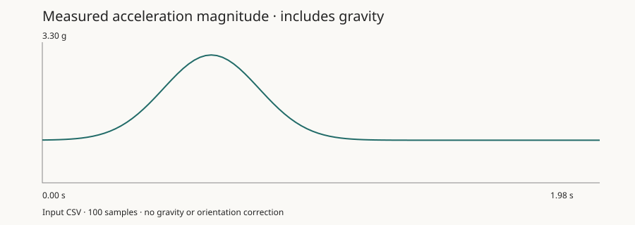

# Rocket

An experimental water-bottle rocket project spanning embedded sensor logging, flight-data analysis, and numerical simulation. Built to investigate how water volume and initial pressure affect lift-off acceleration, with a 3D-printed clamp launcher and an instrumented bottle.

The interesting engineering is the whole measurement loop: read an IMU and barometer, capture a flight, inspect timing and units, then compare observations with a model.

## Run the analysis without hardware

Python 3.10+; the supported entry point uses only the standard library.

```sh
python3 analyze_flight.py examples/synthetic-flight.csv --json summary.json --svg acceleration.svg
python3 -m unittest discover -s tests -v
```

Open `acceleration.svg` in a browser. The bundled CSV is **synthetic demonstration data**, not an experimental launch or evidence for the research conclusions.



For a real recording, replace the input path with a CSV containing these numeric columns:

| Column | Unit |
| --- | --- |
| `Time(ms)` | Milliseconds since recording began; strictly increasing |
| `AccelX(g)`, `AccelY(g)`, `AccelZ(g)` | Measured acceleration in g, including gravity |
| `Pressure(Pa)` | Positive pressure in pascals |

Other columns are allowed. Save just the CSV header and rows from a serial download; exclude console messages such as `Download complete.` The CLI rejects missing columns, invalid numbers, nonpositive pressure, and repeated or reversed timestamps. It reports the observed sampling rate and largest interval so gaps remain visible.

## Repository map

| Location | Purpose / status |
| --- | --- |
| `analyze_flight.py` | Reproducible CSV validation, summary, and SVG plot |
| `Arduino-Scripts/` | Experimental logger and calibration sketches; variants retained for comparison |
| `Matlab/waterRocket.m` | Water-rocket model |
| `Matlab/zupt.m` | Inertial-processing experiment |
| `Simulator/calc.html` | Browser calculator; serve with `python3 -m http.server 8000` and open `/Simulator/calc.html` |
| `Simulator/simulation*.py` | Geometry / simulation experiments |
| `sensorProcessing*.py`, `main*.py`, `graph*.py` | Historical analysis scripts with their own dependencies and local-data assumptions |
| `translate.py` | Unrelated video-subtitle experiment; outside the rocket workflow |

## Embedded workflow and measurement limits

The GY-86 sketches target MPU6050 acceleration/rotation, HMC5883L magnetometry, and MS5611 pressure/temperature. `GY-86-Flight-Logger.ino` exposes `start`, `stop`, `status`, `download`, and `clear` over a 115200-baud serial connection. Wiring, board selection, and calibration must match the particular sketch.

That sketch requests **8,130 buffered samples**, requiring hundreds of kilobytes of RAM; it is not an Arduino Uno-sized allocation. Its gyro storage and labels also need review: a degree-per-second scale is labelled rad/s and multiplied into an `int16_t`, which can overflow. The supported analyzer deliberately does not consume those gyro columns. Firmware has not been validated on hardware in this maintenance pass.

Acceleration magnitude includes gravity and cannot by itself provide vertical velocity. The legacy scripts explore orientation estimation and filtering, but those outputs depend on calibration, orientation assumptions, and timestamp handling. The new summary makes no altitude or velocity claim.

## Experimental background

The original project write-up reports comparison across 100+ launches, greater acceleration at higher initial pressures and lower water-to-air ratios, and closer agreement with simulations above 30% water fill. Wind, tilt, and rotational losses were noted as sources of deviation. These are historical project observations: the underlying launch recordings and report are not bundled here, so the new demo does not reproduce or independently verify those results.

## Development

Keep measured data separate from demonstration fixtures. Include the board, sketch revision, calibration, units, and test conditions with future datasets. Run the analysis checks before changing the CSV contract.

[Apache License 2.0](LICENSE).
